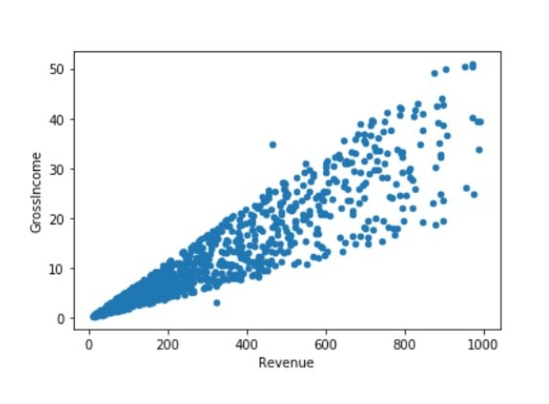

<div align="center">

  

  # 📚 ThoDev (ViBook) — Modern Academic & Social Network

  <p align="center">
    <strong>Mạng xã hội học thuật, kết nối sinh viên, chia sẻ tài liệu ôn thi và nền tảng blog tri thức công nghệ thế hệ mới.</strong>
  </p>

  <p align="center">
    <i>“Kết nối đam mê, chia sẻ khoảnh khắc học tập và phát triển bản thân.”</i>
  </p>

  <div>
    
    
    
    
    
    
  </div>

  <br />

  <p align="center">
    <a href="#-tính-năng-nổi-bật"><strong>Khám phá tính năng »</strong></a> •
    <a href="#-cài-đặt--hướng-dẫn-chạy"><strong>Bắt đầu nhanh »</strong></a> •
    <a href="#-kiến-trúc--công-nghệ"><strong>Công nghệ sử dụng »</strong></a> •
    <a href="#-quy-chuẩn-thiết-kế-design-system"><strong>Design System »</strong></a>
  </p>

</div>

---

## 📖 Mục Lục

- [Giới thiệu tổng quan](#-giới-thiệu-tổng-quan)
- [Hình ảnh & Giao diện minh họa](#-hình-ảnh--giao-diện-minh-họa)
- [Tính năng nổi bật](#-tính-năng-nổi-bật)
  - [1. Xác thực & Bảo mật đa tầng (Authentication)](#1-xác-thực--bảo-mật-đa-tầng-authentication)
  - [2. Bảng tin cộng đồng (Social Feed)](#2-bảng-tin-cộng-đồng-social-feed)
  - [3. Kho tài nguyên & Ôn thi trắc nghiệm (Academic Resources & Quiz)](#3-kho-tài-nguyên--ôn-thi-trắc-nghiệm-academic-resources--quiz)
  - [4. Nền tảng Blog học thuật & Kỹ thuật](#4-nền-tảng-blog-học-thuật--kỹ-thuật)
  - [5. Video Hub & Trình phát Ambient PiP toàn ứng dụng](#5-video-hub--trình-phát-ambient-pip-toàn-ứng-dụng)
  - [6. Nhóm học tập, Sự kiện & Bạn bè](#6-nhóm-học-tập-sự-kiện--bạn-bè)
  - [7. Tin nhắn trực tiếp thời gian thực (Messenger)](#7-tin-nhắn-trực-tiếp-thời-gian-thực-messenger)
  - [8. Sàn sách & Tài liệu giáo trình (Marketplace)](#8-sàn-sách--tài-liệu-giáo-trình-marketplace)
  - [9. Trợ lý AI Thông Minh (ThoDev Mascot Chatbot)](#9-trợ-lý-ai-thông-minh-thodev-mascot-chatbot)
  - [10. Trò chơi giải trí (Mini-games)](#10-trò-chơi-giải-trí-mini-games)
  - [11. Hệ thống giao diện Theme kép & Đa ngôn ngữ](#11-hệ-thống-giao-diện-theme-kép--đa-ngôn-ngữ)
- [Kiến trúc & Công nghệ](#-kiến-trúc--công-nghệ)
- [Cấu trúc thư mục dự án](#-cấu-trúc-thư-mục-dự-án)
- [Cài đặt & Hướng dẫn chạy](#-cài-đặt--hướng-dẫn-chạy)
- [Quy chuẩn thiết kế (Design System)](#-quy-chuẩn-thiết-kế-design-system)
- [Đóng góp & Giấy phép](#-đóng-góp--giấy-phép)

---

## 🌟 Giới thiệu tổng quan

**ThoDev (ViBook)** là nền tảng mạng xã hội chuyên biệt dành cho học thuật, chia sẻ tri thức công nghệ và kết nối cộng đồng người học. 

Khác với các ứng dụng đọc sách thụ động hoặc các nền tảng mạng xã hội giải trí thông thường, ThoDev tập trung giải quyết bài toán:
1. **Trải nghiệm đọc tối ưu (Content-First):** Giao diện phẳng tinh tế, nhịp điệu không gian chuẩn mực, loại bỏ phiền nhiễu thị giác để bảo vệ mắt trong các phiên đọc và nghiên cứu tài liệu kéo dài.
2. **Kho học liệu đại học toàn diện:** Hệ thống tài liệu tổng hợp, ngân hàng câu hỏi trắc nghiệm, thẻ ghi nhớ (Flashcards) cho các môn học đại học phổ biến (Triết học, Tư tưởng, Pháp luật, Lập trình, Kỹ thuật số,...).
3. **Môi trường kết nối tri thức:** Viết blog công nghệ với trình soạn thảo giàu định dạng (Quill), bình luận phân cấp (Threaded comments), tương tác thả cảm xúc và trao đổi tài liệu thông qua hệ thống Chatbot AI.
4. **Hệ thống trải nghiệm xuyên suốt:** Hỗ trợ xem tự do với vai trò Khách (Guest Mode), chế độ nền tối/sáng với hiệu ứng WebGL CursorGrid mượt mà, cùng khả năng đóng gói ứng dụng di động Android nguyên bản nhờ Capacitor.

---

## 🖼️ Hình ảnh & Giao diện minh họa

<div align="center">

| **Bảng tin & Khám phá tri thức** | **Xác thực bảo mật & Nền WebGL** |
|:---:|:---:|
|  |  |
| *Bảng tin cập nhật bài viết, tài liệu học tập và thảo luận theo thời gian thực* | *Hệ thống đăng nhập bảo mật với Anti-Bot Slider & hiệu ứng lưới CursorGrid* |

| **Ngân hàng ôn thi & Trắc nghiệm** | **Nền tảng Blog kỹ thuật & Học thuật** |
|:---:|:---:|
| <br /> |  |
| *Luyện thi trắc nghiệm tương tác cao kèm giải thích đáp án và Flashcard* | *Đọc & soạn thảo bài viết kỹ thuật chuyên sâu với rich-text editor hiện đại* |

| **Trợ lý AI Mascot Đồng Hành** | **Trò chơi thư giãn trí tuệ** |
|:---:|:---:|
|  |  |
| *Robot AI tích hợp trực tiếp hỗ trợ giải đáp thắc mắc và hướng dẫn sử dụng* | *Mini game Cờ Caro 3x3 giải tỏa căng thẳng sau những giờ ôn thi căng thẳng* |

| **Giao diện đa thiết bị & Di động** | **Chế độ sáng / tối đồng bộ** |
|:---:|:---:|
|  |  |
| *Đóng gói Hybrid Android mượt mà, tối ưu trên cả desktop lẫn tablet và smartphone* | *Hỗ trợ đồng bộ giao diện Tối/Sáng tức thì kèm 5 bảng màu khí quyển linh hoạt* |

</div>

---

## ⚡ Tính năng nổi bật

### 1. Xác thực & Bảo mật đa tầng (Authentication)
- **Đăng nhập & Đăng ký an toàn:** Sử dụng Firebase Authentication với xác thực qua Email/Password và Google OAuth 2.0.
- **Xác minh bảo mật con người (Anti-Bot Slider):** Thanh trượt xác minh cảm ứng chống spam bot thông minh với hiệu ứng kính mờ (Glassmorphism).
- **Cơ chế chống dò quét mật khẩu (Rate Limiting):** Tự động khóa tạm thời 60 giây sau 5 lần nhập sai liên tiếp, lưu trạng thái chống can thiệp.
- **Bắt buộc xác thực Email:** Người dùng đăng ký mới bắt buộc phải kích hoạt email trước khi truy cập đầy đủ các chức năng cá nhân.
- **Nền tương tác WebGL CursorGrid:**
  - **Dark Mode:** Lưới ánh sáng trắng (`#ffffff`) mờ ảo trên nền đen sâu (`#0c0d14`) với quầng hào quang tím/xanh kỳ ảo.
  - **Light Mode:** Kích hoạt `lightMode={true}` với đường lưới xám đá phiến (`#64748b`) cùng hiệu ứng bung sóng tím lavender đặc trưng (`#8e54e9`).
- **Segmented Theme Switcher:** Nút chuyển đổi nhanh giao diện dạng phân đoạn `[ ☀️ Sáng | 🌙 Tối ]` ngay góc trên màn hình đăng nhập/đăng ký.

### 2. Bảng tin cộng đồng (Social Feed)
- **Đăng bài viết đa phương tiện:** Hỗ trợ tải ảnh lên đám mây Cloudinary, chèn emoji tự chọn, định dạng nội dung văn bản.
- **Hệ thống tương tác đầy đủ:** Bày tỏ cảm xúc (Thích/Reaction), bình luận nhiều cấp bậc theo thời gian thực (Real-time threaded comments).
- **Chế độ xem cho Khách (Guest Mode):** Cho phép người dùng chưa đăng nhập đọc bài viết, xem nhóm và tìm kiếm mà không bị gián đoạn; chỉ yêu cầu đăng nhập khi thực hiện hành động tạo dữ liệu (Like, Comment, Post).

### 3. Kho tài nguyên & Ôn thi trắc nghiệm (Academic Resources & Quiz)
- **Tổng hợp môn học đại học:** Cung cấp tài liệu và ngân hàng câu hỏi ôn tập chuyên ngành:
  - Các môn Lý luận chính trị: `MLN111`, `MLN122`, `MLN131`, `HCM202`, `VNR202`
  - Các môn Kỹ thuật & Công nghệ: `ITE302c`, `DPS201c`, `PMG201c`, `LAE101`
- **Bộ Flashcard tương tác:** Lật thẻ ghi nhớ câu hỏi - câu trả lời trực quan giúp ghi nhớ nhanh các thuật ngữ và khái niệm.
- **Trắc nghiệm tính điểm tự động:** Thi thử trực tiếp trên nền web với tính năng đếm ngược thời gian, chấm điểm và xem giải thích chi tiết từng câu.

### 4. Nền tảng Blog học thuật & Kỹ thuật
- **Soạn thảo văn bản chuyên sâu:** Tích hợp `react-quill-new` cho phép tạo bài viết đẹp mắt, hỗ trợ code block, trích dẫn, tiêu đề phân cấp.
- **Tối ưu hóa SEO toàn diện:** Sử dụng `react-helmet-async` cùng tập lệnh tự động tạo `sitemap.xml` động (quét trực tiếp từ Firestore BlogPosts, Sản phẩm, Tài liệu).
- **Hệ thống bài viết phân loại:** Danh mục bài viết đa dạng từ Lập trình, Trí tuệ nhân tạo, Thiết kế UI/UX đến Kinh nghiệm học tập.

### 5. Video Hub & Trình phát Ambient PiP toàn ứng dụng
- **Video Player toàn cục (Global Player):** Hỗ trợ tính năng Thu nhỏ cửa sổ xem video (Picture-in-Picture) tiếp tục phát ở góc màn hình khi người dùng chuyển hướng sang trang khác.
- **Ambient Lighting Mode:** Chế độ phát sáng viền thông minh tự động mở rộng dải màu từ video ra nền xung quanh để tạo cảm giác rạp chiếu sống động.

### 6. Nhóm học tập, Sự kiện & Bạn bè
- **Hệ thống Nhóm (Groups):** Tạo nhóm học tập, duyệt thành viên, đăng bài nội bộ, chia sẻ hình ảnh media và tài liệu riêng cho từng nhóm.
- **Lịch sự kiện (Events):** Tổ chức và đăng ký tham gia các buổi hội thảo trực tuyến (Webinar), ngày hội sách và gặp gỡ học thuật.
- **Mạng lưới Bạn bè (Friends):** Gợi ý kết bạn, gửi lời mời kết bạn, quản lý danh sách bạn thân.

### 7. Tin nhắn trực tiếp thời gian thực (Messenger)
- Nhắn tin 1-1 qua Firebase Firestore và WebSocket với độ trễ tối thiểu.
- Hiển thị trạng thái đang nhập (typing), thời gian gửi tin nhắn và trạng thái đọc/chưa đọc.
- Gửi tệp hình ảnh tối ưu dung lượng tự động.

### 8. Sàn sách & Tài liệu giáo trình (Marketplace)
- **Mua sắm tài liệu:** Danh mục sách giáo trình, tài liệu bài giảng đã qua sử dụng hoặc bản mềm.
- **Giỏ hàng & Đặt hàng:** Tích hợp `CartProvider` theo dõi trạng thái giỏ hàng, quy trình thanh toán Checkout rõ ràng và lịch sử đơn hàng `OrdersPage`.
- **Bảng điều khiển người bán (Seller Dashboard):** Cho phép sinh viên đăng bán tài liệu, cập nhật số lượng tồn kho và quản lý doanh thu.

### 9. Trợ lý AI Thông Minh (ThoDev Mascot Chatbot)
- Trợ lý ảo dưới hình tượng Robot ThoDev thân thiện, luôn túc trực ở góc phải màn hình.
- Sử dụng mô hình ngôn ngữ lớn để trả lời câu hỏi học tập, giải thích bài tập và hướng dẫn sử dụng các tính năng trong hệ thống.

### 10. Trò chơi giải trí (Mini-games)
- Tích hợp game Cờ Caro 3x3 (`PlayGame.jsx`) với thuật toán thông minh, giao diện trực quan giúp thư giãn và xả stress sau các phiên làm việc tập trung.

### 11. Hệ thống giao diện Theme kép & Đa ngôn ngữ
- **Chế độ Giao diện:** Hỗ trợ chuyển đổi nhanh chế độ **Sáng (Light Mode)** và **Tối (Dark Mode)** không bị chớp nháy (Flash of unstyled content).
- **Bảng màu Khí quyển (Atmosphere Backgrounds):**
  - `default`: Nền trắng xám `#f4f2fb` / Đen sâu `#0c0d14`
  - `sky`: Xanh bầu trời thanh nhã `#eef6ff` / `#0b1525`
  - `lavender`: Tím hoa oải hương thơ mộng `#f5f1ff` / `#171225`
  - `mint`: Xanh lá bạc hà tươi mát `#effbf6` / `#0c1d18`
  - `warm`: Vàng cam ấm cúng `#fff7ed` / `#21160f`
- **Hỗ trợ 3 ngôn ngữ:** Tiếng Việt 🇻🇳, English 🇺🇸, và Tiếng Nhật (日本語) 🇯🇵.

---

## 🛠️ Kiến trúc & Công nghệ

```
                    ┌────────────────────────────────────────┐
                    │          ThoDev (ViBook) App           │
                    │   React 19 + Vite + Tailwind CSS v3   │
                    └───────────────────┬────────────────────┘
                                        │
           ┌────────────────────────────┼────────────────────────────┐
           ▼                            ▼                            ▼
┌────────────────────┐       ┌────────────────────┐       ┌────────────────────┐
│   Firebase BaaS    │       │   Media & Assets   │       │   Mobile Runtime   │
│ • Authentication   │       │ • Cloudinary CDN   │       │ • Capacitor 8      │
│ • Cloud Firestore  │       │ • WebGL / OGL      │       │ • Android Native   │
│ • Firebase Hosting │       │ • Framer Motion    │       │ • Responsive Shell │
└────────────────────┘       └────────────────────┘       └────────────────────┘
```

| Tầng kiến trúc | Công nghệ sử dụng | Mục đích chính |
|:---|:---|:---|
| **Frontend Core** | React 19, Vite 7 | Nền tảng SPA hiệu năng cực cao, HMR tức thì |
| **Styling & UI** | Tailwind CSS v3, Bootstrap 5 | Tiện ích tiện lợi, bố cục lưới chuẩn, Glassmorphism |
| **Animation & WebGL** | Framer Motion, OGL, Canvas WebGL 2.0 | Hiệu ứng chuyển cảnh mượt mà, lưới động CursorGrid |
| **Backend & Database** | Firebase Authentication, Cloud Firestore | Xác thực bảo mật, cơ sở dữ liệu NoSQL thời gian thực |
| **Lưu trữ đa phương tiện** | Cloudinary React SDK | Lưu trữ ảnh bài viết, bìa sách và media tốc độ cao |
| **Mobile Integration** | Capacitor 8 | Đóng gói ứng dụng di động Android nguyên bản |
| **State Management** | React Context API | Quản lý Theme, Ngôn ngữ, Tìm kiếm, Giỏ hàng, Video Player |
| **SEO & Routing** | React Router DOM v7, React Helmet Async | Điều hướng linh hoạt, tối ưu hóa công cụ tìm kiếm |

---

## 📂 Cấu trúc thư mục dự án

```text
Vibook/
├── .firebase/                 # Cấu hình cache và hosting Firebase
├── android/                   # Dự án Android nguyên bản (Capacitor)
├── docs/                      # Tài liệu nghiệp vụ (BRD, Auth Rules)
│   ├── AUTH_PUBLIC_PRIVATE.md
│   └── BUSINESS_RULES.md
├── public/                    # Tài nguyên tĩnh công khai
│   ├── images/
│   │   ├── blog/              # Ảnh bìa bài viết blog
│   │   ├── mascot/            # Bộ ảnh Mascot Robot ThoDev
│   │   └── ite302c/           # Ảnh học liệu môn học
│   └── sitemap.xml            # Sitemap SEO tự động tạo
├── scripts/                   # Kịch bản bảo trì & sinh sitemap
│   └── generate-sitemap.js
├── src/
│   ├── assets/                # Biểu tượng và tài nguyên svg
│   ├── components/            # Các thành phần giao diện tái sử dụng
│   │   ├── auth/              # Bộ bảo vệ route đăng nhập
│   │   ├── chatbot/           # MascotChatbot AI
│   │   ├── header/            # Điều khiển Theme, Language, Search
│   │   ├── post/              # PostItem, bình luận, tương tác
│   │   ├── shop/              # Quản lý hàng hóa, sản phẩm
│   │   ├── video/             # GlobalPlayer, VideoHub components
│   │   ├── CursorGrid.jsx     # Nền động WebGL tương tác chuột
│   │   ├── Header.jsx         # Thanh điều hướng trên cùng
│   │   ├── Sidebar.jsx        # Thanh thanh tác vụ bên trái
│   │   ├── login.jsx          # Giao diện Đăng nhập
│   │   └── register.jsx       # Giao diện Đăng ký
│   ├── context/               # Các React Context Provider
│   │   ├── ThemeContext.jsx   # Xử lý chế độ sáng/tối & màu khí quyển
│   │   ├── LanguageContext.jsx# Quản lý ngôn ngữ hiển thị
│   │   ├── CartContext.jsx    # Quản lý giỏ hàng & sản phẩm
│   │   └── VideoPlayerContext.jsx # Quản lý trình phát video toàn cục
│   ├── pages/                 # Các trang giao diện chính
│   │   ├── blog/              # Trang Blog & xem chi tiết bài viết
│   │   ├── friends/           # Quản lý bạn bè
│   │   ├── group/             # Nhóm thành viên, bài viết nhóm
│   │   ├── store/             # Cửa hàng, Giỏ hàng, Checkout
│   │   ├── video/             # Trung tâm xem video
│   │   ├── Home.jsx           # Bảng tin Feed
│   │   ├── Profile.jsx        # Trang hồ sơ cá nhân
│   │   ├── Messenger.jsx      # Hộp thoại tin nhắn
│   │   └── PlayGame.jsx       # Mini game giải trí
│   ├── style/                 # CSS Design System & Theme
│   │   ├── design-system.css  # Chuẩn màu sắc, token và typography
│   │   ├── auth.css           # Hiệu ứng Glassmorphism cho Login/Register
│   │   └── App.css            # Phong cách khung ứng dụng chung
│   ├── App.jsx                # Bộ định tuyến trung tâm
│   └── main.jsx               # Điểm khởi chạy React ứng dụng
├── DESIGN.md                  # Hướng dẫn chi tiết ThoDev Design System
├── PRODUCT.md                 # Định vị sản phẩm và nguyên tắc cốt lõi
├── capacitor.config.ts        # Cấu hình Capacitor Android
├── tailwind.config.js         # Cấu hình tiện ích Tailwind CSS
└── vite.config.js             # Cấu hình bộ công cụ Vite
```

---

## 🚀 Cài đặt & Hướng dẫn chạy

### 1. Yêu cầu hệ thống
- **Node.js**: Phiên bản `18.x` hoặc `20.x` trở lên
- **NPM**: Phiên bản `9.x` trở lên
- **Firebase CLI** (tùy chọn để deploy): `npm install -g firebase-tools`

### 2. Clone mã nguồn & Cài đặt thư viện
```bash
# Clone repository
git clone https://github.com/HuynhPhucTho-Web/Vibook.git

# Di chuyển vào thư mục dự án
cd Vibook

# Cài đặt toàn bộ dependencies
npm install
```

### 3. Cấu hình biến môi trường
Tạo file `.env` ở thư mục gốc và cung cấp thông tin kết nối dịch vụ:

```env
# Firebase Configuration
VITE_FIREBASE_API_KEY=your_firebase_api_key
VITE_FIREBASE_AUTH_DOMAIN=your_project.firebaseapp.com
VITE_FIREBASE_PROJECT_ID=your_project_id
VITE_FIREBASE_STORAGE_BUCKET=your_project.appspot.com
VITE_FIREBASE_MESSAGING_SENDER_ID=your_messaging_sender_id
VITE_FIREBASE_APP_ID=your_app_id
VITE_FIREBASE_MEASUREMENT_ID=your_measurement_id

# Cloudinary Media Configuration
VITE_CLOUDINARY_CLOUD_NAME=your_cloud_name
VITE_CLOUDINARY_UPLOAD_PRESET=your_upload_preset
```

### 4. Chạy môi trường phát triển (Development)
```bash
npm run dev
```
Truy cập ứng dụng tại: `http://localhost:5173`

### 5. Build sản phẩm (Production)
Tập lệnh sẽ tự động cập nhật bản đồ trang web `sitemap.xml` và đóng gói mã nguồn:
```bash
npm run build

# Xem thử bản dựng production
npm run preview
```

### 6. Triển khai lên Firebase Hosting
```bash
# Đăng nhập Firebase (nếu chưa đăng nhập)
firebase login

# Deploy website lên Firebase Hosting
firebase deploy
```

### 7. Đồng bộ & Khởi chạy trên Android (Capacitor)
```bash
# Đồng bộ mã nguồn web sang dự án native Android
npx cap sync android

# Mở dự án trong Android Studio để chạy trên máy thật hoặc giả lập
npx cap run android
```

---

## 🎨 Quy chuẩn thiết kế (Design System)

Chi tiết đầy đủ xem tại [`DESIGN.md`](./DESIGN.md).

### Bảng màu nhận diện thương hiệu
- **Deep Lavender** (`#8e54e9`): Màu chủ đạo chính cho các nút hành động, trạng thái được chọn và nhận diện thương hiệu ThoDev.
- **Electric Blue** (`#4776e6`): Màu phụ trợ cho viền tương tác, hiệu ứng phát sáng khi focus và liên kết nổi bật.
- **Void Black** (`#0c0d14`): Màu nền chiều sâu cho không gian ban đêm.
- **Warm Paper** (`#faf7f2` / `#f4f2fb`): Tông giấy đọc sách êm dịu cho ban ngày.

### Quy chuẩn kích thước khung chứa (Layout Rhythm)
- **Container chuẩn trang chính:** `max-width: 1200px; margin: 0 auto;`
- **Dashboard / Video Hub:** `max-width: 1400px; margin: 0 auto;`
- **Hộp thoại Modal:** `max-width: 680px; margin: 0 auto;`
- **Giao diện di động (≤ 820px):** `width: 100%; padding: 0.5rem;`
- **Hệ nhịp khoảng cách (Spacing Unit):** Bội số chuẩn 8px (`8px`, `16px`, `24px`, `32px`, `64px`).
- **Typography:** Ghép nối giữa font sans-serif hiện đại **Hanken Grotesk** và font monospaced **JetBrains Mono** cho nhãn dữ liệu/code.

---

## 👨‍💻 Tác giả & Đóng góp

- **Nhà phát triển chính:** **Huỳnh Phúc Thọ (Tho Web)**
- **GitHub:** [@HuynhPhucTho-Web](https://github.com/HuynhPhucTho-Web)
- **Dự án:** [Vibook Repository](https://github.com/HuynhPhucTho-Web/Vibook)

Mọi ý kiến đóng góp, báo cáo lỗi (Issue) hoặc yêu cầu kéo (Pull Request) đều luôn được hoan nghênh và đánh giá cao!

---

## 📄 Giấy phép (License)

Dự án được phân phối dưới giấy phép **MIT License**. Chi tiết tham khảo tại tệp `LICENSE` trong mã nguồn.

<div align="center">
  <sub>Xây dựng với tất cả sự tâm huyết dành cho cộng đồng học thuật và những người yêu thích đọc sách. ❤️</sub>
</div>
